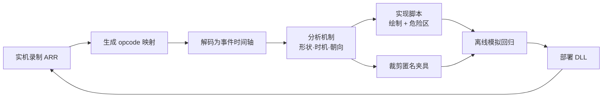

# ARR 解析与模拟流程

> 面向 AI 代理与开发者：从一份实战录像出发，解析出机制时间轴，写成绘制/躲避逻辑，再用离线模拟验证，最后回到游戏实测。
> 每一轮修复都按这个闭环走，结论必须能在录像或回归里复现。



---

## 1. 两种录像

| | ARR 录像 | PromeRadar 录制 |
|---|---|---|
| 文件 | `.dat`，文件头 `FFXIVREPLAY`，如 `金碟巨豆中心 2026.10.09 01.19.29.dat` | `.mpreplay.jsonl`，插件「录制回放」页或 `/prpr rec` |
| 内容 | 服务器下发的原始封包（读条、效果、移动、状态、场地等），含其他玩家 | PR 事件总线事件 + 0.1s 对象快照，过滤玩家来源动作 |
| 精度 | 封包级时间与坐标，可还原真实命中时刻 | 插件视角，可直接在回放窗口驱动脚本 |
| 用途 | **机制分析与离线夹具的真源** | 回放窗口复现、检查脚本绘制 |

格式细节：`.mpreplay.jsonl` 见 [录制回放格式](录制回放格式.md)；ARR 解析见下文。

---

## 2. 解析 ARR

工具在 [`tools/arr/`](../tools/arr/)，只依赖 Python 3 标准库。

### 2.1 生成 opcode 映射

封包 opcode 每次客户端更新都会重排，必须用**录制该 ARR 的客户端版本**的映射。版本号是 ARR 文件 `0x10` 处的 uint32。

```powershell
python tools/arr/opcode_map.py --game "D:\...\最终幻想XIV\game" --arr "录像.dat"
# 或已知版本号：--build 14101351
```

输出 `tools/arr/maps/opcode-map-<build>.json`（opcode → ServerIPC 序号）。客户端更新后、解析新录像前先重新生成。

### 2.2 解码为事件时间轴

```powershell
python tools/arr/arr_decode.py "录像1.dat" "录像2.dat" --out analysis/<日期>/
```

每个录像生成同名 `.json`：`build`、`content`（副本 ID）、`duration`、各封包计数和 `events`。事件按录像时间排序，每条带：

- `t`：距录像开始的秒数
- `kind`：封包类型
- `id`：来源实体 ID
- 该实体最近一次已知的 `oid` / `pos` / `rot`

### 2.3 文件与封包格式

| 位置 | 含义 |
|---|---|
| `0x00` | `FFXIVREPLAY\0` |
| `0x10` | 客户端 build（uint32） |
| `0x20` | 副本 content ID（uint16） |
| `0x48` | 数据区长度，等于文件长度 − `0x36C` |
| `0x36C` 起 | 封包序列：`opcode u16, size u16, ms u32, actor u32`，后接 `size` 字节负载 |

解码器识别的类型（`kind`）：

| kind | 关键字段 | 说明 |
|---|---|---|
| `cast` | `action` `seconds` `target` `rotation` `loc` | 读条开始。`loc` 为锁定落点，`rotation` 为锁定朝向 |
| `effect1/8/16/24/32` | `action` `seq` `targets` | 实际生效时刻；`seq` 为全局序号，用于去重和对齐读条 |
| `control*` | `category` `params[4]` | ActorControl：状态、点名图标、连线、死亡等 |
| `npc` / `boss` | `oid` `pos` `rot` | 生成战斗对象，`oid` 即 Data ID |
| `object` | `oid` `entity` `layout` `pos` `rot` | 生成 EObj（场地物件） |
| `move` / `setpos` | `pos` `rot` | 位置更新；`move` 坐标量化为 `x·2000/65535 − 1000` |
| `map*` | `index` `state` | 场地效果（MapEffect） |
| `despawn` / `despawnobj` | `id` | 对象移除 |
| `movestate` | `raw` | 移动状态封包（地面/黏液/滑落/击飞），保留原始负载 |

约定：角度为弧度，`0 = +Z`、`π/2 = +X`；坐标 X/Z 为地面平面，Y 为高度。默认只输出上表类型，`--all` 保留全部封包。

---

## 3. 分析机制

先把录像缩到一场战斗，再逐个技能建立「读条 → 生效」的对应关系。

1. **定位战斗窗口**：按 Boss `oid` 的生成、首个读条和死亡/移除划定起止时间。
2. **列出技能**：统计窗口内 `cast` 与 `effect*` 的 `action`。同一技能可能由 Boss 和多个 helper（不可见的辅助实体）同时施放，要按来源分组。
3. **确定形状与尺寸**：查客户端 Action 表（CastType、EffectRange、XAxisModifier、Omen 路径）。CastType 与形状的对应见 `src/Movement/Dodge/AoeShapeDatabase.cs`：2/5 圆、3/13 扇形（开角取 Omen `fanXXX`）、4/12 矩形、8 冲锋、10 月环（内径取 Omen 名）。表里查不到的，用命中玩家的位置反推并标注为推断。
4. **确定位置与朝向**：
   - 用读条的锁定 `loc` / `rotation`，不要用读条期间施法者的实时位置；
   - 有的技能生效朝向与读条朝向不同（曾出现相差 90°），以 `effect` 为准核对；
   - `self` 类技能的落点是施法者，`location` 类是 `loc`。
5. **确定时机**：
   - 真实命中时间取 `effect` 的 `t`，不是读条结束时间；
   - NPC 读条通常比显示晚约 0.3s 结算，代码里统一按 `FinishAt + 0.3`；
   - 连续波次逐波记录间隔，确认是固定节奏还是随网络抖动。录像里出现过封包晚到约 0.85s 的情况，这种接触只能记为警告，不能当作逻辑错误。
6. **状态、点名与场地**：`control` 的 `category` 区分状态增减、图标、连线；`map` / `object` 动画决定场地变化。记录它们与后续 `cast` 的固定提前量。
7. **玩家运动**：需要模拟走位时，用 `move` 拟合真实运动：速度与朝向的关系、停步、转向速率、强制移动或滑落状态。测试里的移动模型必须复现这些限制，否则会通过理想化测试却在实机失败。

产出：一份分析笔记，至少包含技能 ID、来源、形状尺寸、锁定方式、真实命中时间与证据（录像时间点）。写入对应的 `docs/reference/<区域>.spec.md`。

---

## 4. 实现绘制与躲避

机制脚本继承 `MasterPlayerScript`，用三个门面输出结果（API 详见 [脚本开发指南](脚本开发指南.md)）：

| 门面 | 作用 |
|---|---|
| `SafeZone` | 注册危险区／安全区／障碍，参与解算与自动走位 |
| `Draw` | 只显示的 AOE 预览、连线与标记，不参与解算 |
| `Move` | 直接移动（一般不用，交给解算器） |

最小示例：读条时登记一个带时间窗的危险区并显示原尺寸预览。

```csharp
[MechanicScript("示例区域", [1234u], "example.area", "1.0.0", "作者", "B1 圆形 AOE")]
public sealed class ExampleArea : MasterPlayerScript
{
    private const uint Smash = 12345;

    protected override void OnStart()
    {
        SuppressGenericDodge(Smash);              // 由脚本接管，避免通用躲避重复登记
        OnStartCast(e =>
        {
            if (e.ActionId != Smash) return;
            var template = new CircleTemplate(10);
            var binding = new StaticTransform(e.EffectPosition, 0);   // 锁定落点快照
            SafeZone.AddDelayedHit(template, binding, e.CastTime + 0.3f);
            Draw.AddAoe($"smash/{e.SourceId}", template.Resolve(e.EffectPosition, 0, null), false, (e.CastTime + 0.3f) * 1000);
        });
    }
}
```

要点：

- **快照而非跟随**：落点和朝向在读条开始锁定后用 `StaticTransform`；需要朝向时用 `CastRotation.TryGet(e, out var rotation)`，取不到就跳过，不要回退到普通朝向。
- **生命周期**：读条取消、打断、施法者死亡、生效后都要撤销对应区域；脚本停止时门面会自动清理。
- **显示与解算分离**：预览用原尺寸，导航余量由用户设置统一外扩，不要在脚本里重复加大。
- **复杂机制**：多波次、击退、引导等参考 `Presets/Crucible/` 与 `Presets/Blunderville/` 的实现，以及对应 spec。

---

## 5. 制作离线夹具

把分析过的片段裁成小而匿名的 JSON，放进 `tests/Fixtures/<区域>/`，命名带录像时间，如 `low2-225025.json`、`feedback-234521.json`。

- **只保留需要的数据**：战斗窗口内相关的 `cast`、`effect`、对象生成和位置，以及玩家参考位置。
- **匿名化**：去掉玩家名字和真实实体 ID，实体编号换成测试内局部编号。
- **可追溯**：记录来源录像名与 `sha256`，便于以后回到原文件核对。

示例结构（斗兽夹具）：

```json
{
  "source": "斗兽奇弈 第二盘 2026.09.19 22.50.25.dat",
  "sha256": "cb3712d2…",
  "fights": [{
    "key": "stomp", "nameId": 14555, "oid": 19551,
    "boss": [119.98, 0.08, -5.02], "player": [119.19, -0.02, 2.27],
    "casts": [{ "actor": 10, "action": 48202, "start": 0.0, "finish": 10.5, "hit": 10.443, "origin": [135.0, 0, 0] }]
  }]
}
```

---

## 6. 离线模拟验证

回归程序 `tests/MasterPlayer.RegressionTests.csproj` 直接编译插件源码，不需要启动游戏。模拟场景一般这样搭：

1. 读入夹具，按时间把读条、效果、对象变化喂给**真实的**机制组件（不是复制的测试版逻辑）。
2. 用录像时钟驱动 `SafeZoneRuntime` 与解算器（`ReplayClock`），后台解算按真实耗时或固定延迟交付。
3. 用符合实测物理的移动模型推进玩家，叠加脚本刷新周期（约 100ms）、解算延迟（80/300ms）和起步延迟（约 80ms）。
4. 判定：玩家是否在真实命中时刻站在任一危险区内、是否按时完成路线、是否出现异常停顿。

常用命令：

```powershell
# 全量
dotnet run --project tests/MasterPlayer.RegressionTests.csproj -c Release -- --keep-going
# 定向
dotnet run --project tests/MasterPlayer.RegressionTests.csproj -- --filter="Recorded low-two"
# 多进程分片（会把解算延迟固定，避免 CPU 争用影响结果）
.\run-tests.ps1 -Filter Blunderville
```

| 开关 | 作用 |
|---|---|
| `--filter=<片段>` | 只跑名称包含该片段的场景 |
| `--keep-going` | 失败后继续，列出全部失败 |
| `--shard=i/n` | 分片运行 |
| `MP_SIM_FIXED_LATENCY=1` | 不把实测解算耗时计入延迟 |
| `OBS_WORKER=0.35` / `OBS_PHASES=1` | 糖豆人障碍场景使用固定搜索延迟、24 相位扫描，便于对比 |

判读规则：

- **先跑基线**：在改动前的提交上跑同一批场景，与改动后并排对比。部分糖豆人场景依赖真实 CPU 时间，单次通过或失败都不能作为结论。
- **新问题先复现**：先写出能在夹具上失败的场景，再修复让它通过。
- **测试不等于实机**：离线全绿只说明录像中的已知情况被覆盖，仍需回到游戏验收。

其他检查：

```powershell
# 内置脚本编译 + 实际 DLL 冒烟
dotnet run --project tests/ScriptCompilation/MasterPlayer.ScriptSmoke.csproj -- . <MasterPlayer.dll 路径>
# 机制运行库（需本机游戏数据）
dotnet run --project tests/MechanicRuntime/MasterPlayer.MechanicRuntime.Tests.csproj -- . "D:\...\game\sqpack"
```

---

## 7. 部署与实机验收

1. 备份插件目录中的 `MasterPlayer.dll` / `MasterPlayer.MechanicRuntime.dll`（含 `.pdb`），加时间戳后缀。
2. `dotnet build MasterPlayer.csproj -c Release` 直接输出到 PR 插件目录。
3. 游戏内在 PR 插件管理器重载插件，进入对应区域测试，同时录制新的 ARR。
4. 有问题时，记下录像文件名和出问题的时间点，回到第 2 节继续。

---

## 8. AI 执行清单

- [ ] 用录像 build 生成或确认 opcode 映射，解码到 `analysis/` 下的工作目录
- [ ] 找到问题时间点，列出前后 10 秒的读条、效果、状态、玩家位置
- [ ] 每个技能写清：来源、形状尺寸、锁定方式、真实命中时间和证据
- [ ] 判断问题属于识别（漏技能/错形状）、时机、走位规划还是执行
- [ ] 先做能失败的夹具场景，再改代码
- [ ] 跑定向场景和全量回归，与基线对比，说明剩余失败是否原本就有
- [ ] 更新对应 spec，记录版本、证据和仍需实机确认的内容
- [ ] 备份后部署，告诉用户重载插件并录制新 ARR
