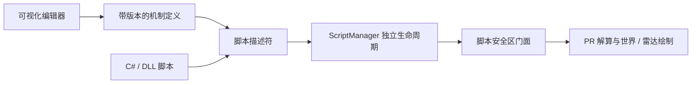

# 可视化脚本编辑器

可视化脚本用于配置独立的读条 AOE：填写读条 ID，设置范围、位置、绑定和判定时间。分阶段逻辑、点名分配、连线推导和复杂走位继续由 C# 脚本实现。

## 使用

1. 重载 MasterPlayer 后，打开 `/prmp` →「脚本」→「可视化编辑器」。已有可视化脚本也可从脚本列表的「编辑」按钮打开。
2. 新建脚本，填写名称和区域 ID；「使用当前区域」可以直接取当前区域。备注可记录 Boss 名称。
3. 添加机制，填写读条 ID（十进制）。选中正在读条的目标后，「读取目标当前读条」可填入技能 ID 和施法者 Data ID。
4. 选择 AOE 形状、位置来源、绑定方式和判定时间，通过二维预览核对范围。拖动预览调整偏移，滑条调整模拟朝向和缩放。
5. 点击「保存并应用」，再勾选「启用脚本」。脚本在匹配区域自动运行，离开区域自动停止。新脚本默认停用；仅修改草稿不会影响运行中的机制。

脚本总开关、真实世界绘制、雷达悬浮窗与智能躲避仍使用现有设置。编辑器预览不会注册危险区或触发移动。

## 界面组织

独立编辑窗口避免挤占设置面板。宽窗口同时显示脚本库、机制列表、属性与预览；较窄窗口将脚本库收进下拉选择，机制列表与属性各自滚动。顶部保留保存、复制、重新读取和删除入口，显示未保存状态。

- **脚本库**：按名称或区域 ID 搜索，显示运行中、已启用等待区域、已停用等状态。
- **机制列表**：显示名称、读条 ID、形状和启用状态；支持添加、复制、删除。
- **机制属性**：按触发条件、形状、位置与绑定、判定时间组织。只展示当前形状需要的参数。
- **预览**：北在上、东在右；蓝点表示位置锚点。范围复用运行时的 PR 几何模板，保留月环孔洞、扇形总开角以及两种矩形的锚点区别。
- **编辑反馈**：参数错误给出文字原因，保存失败保留草稿。切换文档、重新读取或关闭窗口时，可选择保存、放弃修改或取消；删除前确认。

## 机制参数

| 参数 | 语义 |
|---|---|
| 读条 ID | 对应 `OnStartCast` 的技能编号，1～65535，十进制 |
| 施法者 Data ID | 怪物种类编号，即 Dalamud `BaseId`；0 表示任意施法者。每条机制单独配置，以支持 Boss 的不同辅助实体 |
| 圆形 | 半径，锚点在圆心 |
| 月环 | 内半径、外半径；内半径小于外半径 |
| 扇形 | 半径、总开角（度），不是半开角 |
| 中心矩形 | 全宽、全长，锚点在矩形中心 |
| 射线矩形 | 全宽、全长，锚点在后边中心，沿朝向向前延伸 |
| 角度偏移 | 在基准朝向上额外旋转，单位为度；扇形、中心矩形、射线矩形均支持，默认 0 |
| 读条结束后延迟 | 非负秒数，最多 300 秒 |
| 判定持续时间 | 大于 0、最多 300 秒，默认 0.6 秒 |
| 接管通用躲避 | 仅在本次读条匹配启用规则、位置与朝向可解析、判定尚未过期时，跳过通用躲避的重复注册 |

可配置多个相同读条 ID 的机制，组合不同形状或位置；它们会各自注册一个危险区。当前版本只生成危险 AOE，安全点、硬障碍及复杂状态逻辑使用 C# 脚本。

### 位置与绑定

| 位置来源 | 取值 |
|---|---|
| 施法者 | 事件里的施法者位置快照；缺失时尝试对象表 |
| 技能落点 | 读条包的 `EffectPosition`，适合落地圆、落地扇形等 |
| 读条目标 | 处理读条时目标实体的实际位置；找不到目标时跳过，不把技能落点当作目标位置 |
| 固定坐标 | 手填 X/Y/Z，或取玩家、当前目标的坐标；Y 是高度 |

施法者和目标支持三种绑定。技能落点与固定坐标仅支持锁定位置。

- **读条开始时锁定**：固定位置与朝向；偏移使用世界 X/Z 坐标。
- **持续跟随位置**：跟随本次实体的位置，保持初始朝向；偏移使用世界 X/Z 坐标。
- **持续跟随位置与普通朝向**：位置与普通朝向一起更新；偏移使用实体局部坐标，X 向右、Z 向后。

世界 X 向东、Z 向南；固定角度 0° 向南、90° 向东、180° 向北。绑定实体使用读条事件中的 Entity ID；用户填写的 Data ID 只用于筛选，不能拿来跟随。

方向性形状可锁定施法朝向、施法者普通朝向或固定角度。施法朝向必须通过 `CastRotation.TryGet` 读取当前匹配读条，失败则记录原因并跳过；圆形与月环不依赖朝向。跟随实体消失时移除区域。

「位置与绑定」中的「角度偏移（度）」用于背向或侧向机制：`+90°` 左转、`-90°` 右转、`180°` 反向。例如施法者朝北，偏移 `+90°` 后范围朝西。超过一圈按等效角度处理，如 `450°` 等效于 `90°`；旧文档未填写此参数时按 `0°` 执行。

角度偏移适用于锁定位置、跟随位置、跟随位置与普通朝向三种模式。最后一种模式随实体转向持续保持该偏角。它只旋转 AOE，位置偏移仍按原有世界或实体局部坐标计算；预览蓝线表示叠加前的基准朝向，范围显示叠加后的结果。

预览使用模拟朝向和位置锚点，固定坐标会作为游戏内实际锚点。预览尺寸不包含全局 `DodgeDangerMargin`；真实注册仍统一应用智能躲避安全余量。

### 时间与清理

读条开始即注册预告，实际危险窗口为读条结束时间加延迟，再持续指定秒数。运行器根据事件时间扣除排队耗时；已经开始的窗口只保留剩余部分，已经结束的事件不会重新生成预告。

取消或打断只清理该施法者最新一次相应读条，不删除此前读条已经生成的延迟 AOE。战斗结束、脚本停止、离开区域、删除和保存应用时清理本脚本的区域。更新运行中的脚本会清除它的旧预告，从下一次读条开始按新定义处理。

## 多脚本与保存

脚本身份是独立 GUID，区域 ID 和 Boss/Data ID 都不作为唯一键。同一区域可以运行多份可视化脚本，并与 C# 脚本同时运行。复制脚本会生成新的脚本及机制 ID；复制后可独立启停。

编辑器生成的文件位于：

```text
pluginConfigs/PromeRotation/MasterPlayer/Scripts/Visual/<guid>.mechanic.json
```

脚本文件可备份或分享。手动放入脚本目录的 `*.mechanic.json` 会在「刷新脚本」时被扫描；不要直接复制文件而保留相同 GUID 来创建另一份并行脚本，使用编辑器的「复制脚本」。启用状态仍保存在 `MasterPlayer.json`。

「保存并应用」先校验，再写临时文件并替换原文件，随后仅重新创建这一份脚本的运行实例。外部修改或删除过的文件会拒绝覆盖；可用「重新读取」处理冲突。普通「刷新脚本」仍按原有行为刷新整个脚本库。

可视化脚本只注册自己的危险区，不直接操作 GreenMove 或场地边界。多个规则或多个脚本匹配同次读条时允许叠加；通用躲避接管不用于互相屏蔽脚本。

## 实现与扩展



| 位置 | 职责 |
|---|---|
| `Scripting/Visual/VisualScriptDefinition.cs` | 文档与机制参数、校验、PR 几何模板转换 |
| `Scripting/Visual/RotationOffsetTemplate.cs` | 在几何解析时叠加角度，保留位置和形状类型；危险区外扩递归处理其内层模板 |
| `Scripting/Visual/VisualScriptStore.cs` | 格式版本、JSON 读写、复制及文件冲突检查 |
| `Scripting/Visual/VisualAoeBinding.cs` | 事件与实体快照、施法者筛选、位置与绑定解析 |
| `Scripting/Visual/VisualMechanicScript.cs` | 解释执行机制，维护时间窗口、取消与清理 |
| `ScriptManager` | 同一脚本目录加载三种来源，按独立身份管理、增量替换可视化脚本 |
| `Windows/VisualScriptEditor.cs` / `VisualAoePreview.cs` | 草稿与交互、属性控件、几何预览 |

当前格式为 `SchemaVersion = 1`。未知版本、字段或枚举会明确报错，避免编辑旧版本时悄悄丢掉新配置。以后增加状态获得、动作效果等触发方式时，在定义和运行器中增加有明确语义的类型，并同步编辑控件、校验、迁移和行为回归；需要多事件状态机时继续写 C#，不提前引入节点语言或通用表达式执行器。

回归入口为 `dotnet run --project tests/MasterPlayer.RegressionTests.csproj`。无界面测试覆盖数据、几何、过滤、时序与共享注册中心中的运行器清理；实际 ImGui 交互与游戏事件仍需游戏内验收。
